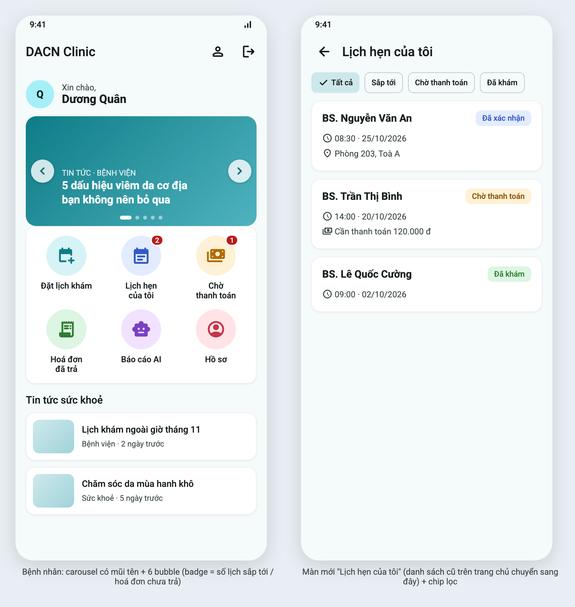
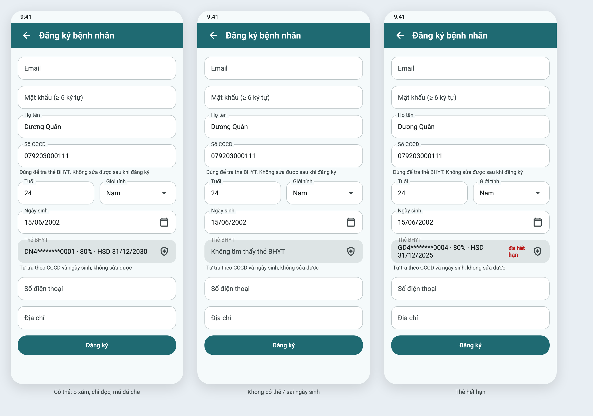
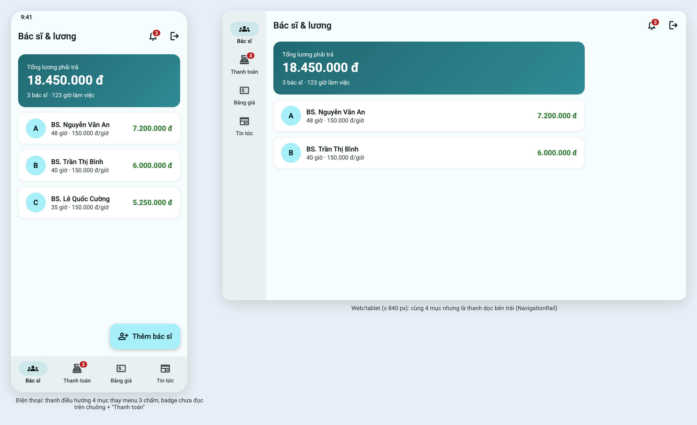
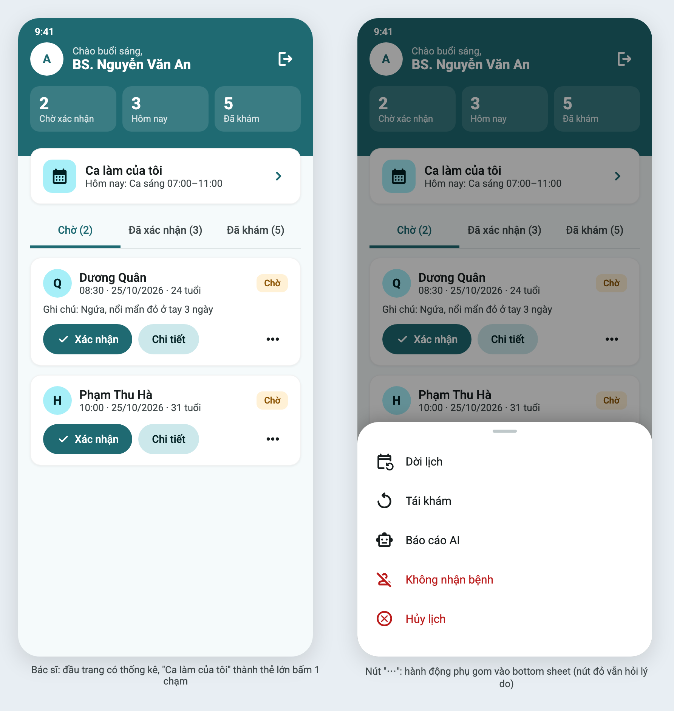

# Pre-implement: template và giao diện dự kiến (spec 05, Phase 9)

Ngày: 2026-10-22 · Trạng thái: **Đã duyệt 2026-10-22** và đã triển khai (spec 05, phase 11–13)

## 1. Template tham khảo

| # | Template | Loại | Giấy phép | Dùng cho | Mượn gì |
|---|---|---|---|---|---|
| 1 | [WECARE – Online Doctor Appointment App UI Kit](https://www.figma.com/community/file/1212272645845576616/Online-Doctor-Appointment-App-UI-Kit---Community) | Figma, mobile, 60+ màn | CC BY 4.0 | **Bệnh nhân** | Lưới "Service Category" icon tròn → **bubble**; thẻ chào ở đầu trang |
| 2 | [Easy Doctor App](https://www.figma.com/community/file/1521872668253096087/easy-doctor-app) | Figma, mobile, 30+ màn | CC BY 4.0 (không bắt buộc ghi nguồn) | Bệnh nhân, bác sĩ | Thẻ lịch hẹn: avatar tròn + chip trạng thái + nút chính; banner tin tức bo góc |
| 3 | [Doct – Doctor Management Web App UI Kit](https://www.figma.com/community/file/1042396052506493532/doct-doctor-management-web-app-ui-kit) | Figma, web dashboard, 125+ màn | CC BY 4.0 | **Bác sĩ, admin** | Đầu trang có **thẻ thống kê**; điều hướng bằng thanh dọc bên trái trên màn rộng |
| 4 | [OmerJahangir/doctors_appointment_app](https://github.com/OmerJahangir/doctors_appointment_app) | Mã Flutter Material 3 | MIT | Tham khảo code | Cách dựng danh mục + danh sách bác sĩ bằng Material 3 thuần |
| — | [Material 3: Navigation bar](https://m3.material.io/components/navigation-bar/overview) / [Navigation rail](https://m3.material.io/components/navigation-rail/overview) | Hướng dẫn chính thức | — | Admin | 3–5 mục → NavigationBar; màn rộng → NavigationRail |

Đã xem nhưng loại: *Pocket Doc* (giấy phép trả phí), *Doccure* (template website, không phải app mobile).

## 2. Hướng chung đề xuất

- **Giữ màu hiện tại** (`seedColor 0xFF0E7C86`, xanh teal) và bo góc 14. Chỉ mượn **bố cục** từ template, không đổi bộ nhận diện.
- Bubble dùng màu nền nhạt riêng cho từng chức năng (như WECARE), giúp nhận ra nhanh.
- Mọi widget vẫn là Material 3 có sẵn (`NavigationBar`, `NavigationRail`, `Badge`, `FilterChip`, `showModalBottomSheet`). **Không thêm thư viện UI.**

## 3. Giao diện dự kiến

Ảnh xuất từ HTML trong `src/` (khổ 390×844, đúng chữ và chức năng của app). Muốn sửa thì sửa HTML rồi chụp lại bằng lệnh ở cuối file.

### Bệnh nhân: trang chủ + màn "Lịch hẹn của tôi"


### Bệnh nhân: ô BHYT khi đăng ký (đã làm ở Phase 10, ảnh thật trong `screenshots/phase-10/`)


### Admin: thanh điều hướng thay menu 3 chấm


### Bác sĩ: thống kê + "Ca làm của tôi" + hành động phụ gom vào bottom sheet


## 4. Ý kiến của bạn

| Màn | Duyệt? | Ghi chú |
|---|---|---|
| Bệnh nhân | ✅ | |
| Admin | ✅ | |
| Bác sĩ | ✅ | |

tôi thấy giao diện hiện tại ổn
## Chụp lại ảnh

```bash
cd pre_implement
C="/Applications/Google Chrome.app/Contents/MacOS/Google Chrome"
"$C" --headless=new --hide-scrollbars --force-device-scale-factor=2 --virtual-time-budget=6000 \
  --window-size=892,940 --screenshot="$PWD/doctor-home.png" "file://$PWD/src/doctor-home.html"
```
